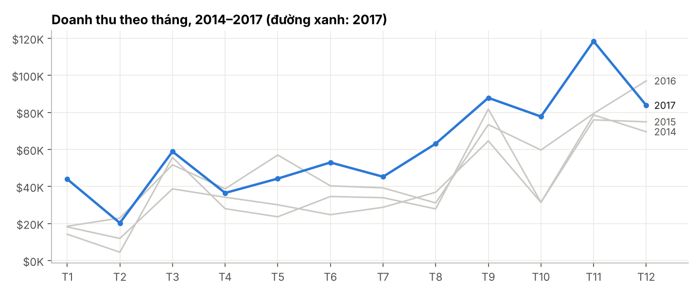
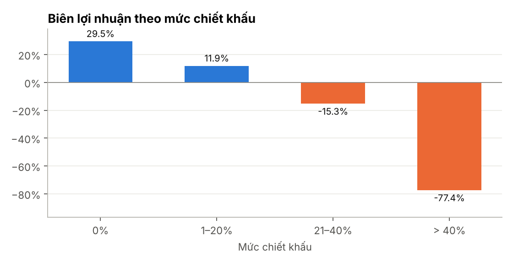
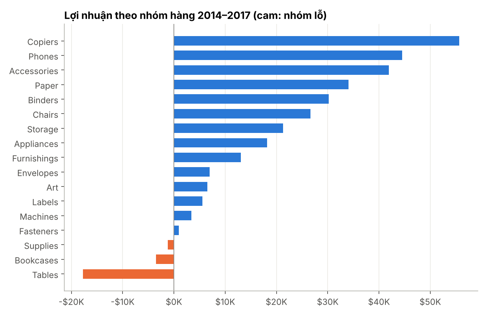

# Dashboard hiệu quả kinh doanh bán lẻ (Superstore)

Xây dựng mô hình dữ liệu dạng sao và bộ measure DAX cho dashboard Power BI theo dõi doanh thu, lợi nhuận và hiệu quả chiết khấu của một chuỗi bán lẻ đồ văn phòng tại Mỹ.

**Công cụ:** Power Query (M) · Power BI (DAX) · Excel (SUMIFS) · Python (pandas – kiểm tra số liệu)
**Dữ liệu:** Sample – Superstore (bộ dữ liệu mẫu của Tableau, lưu tại `data/raw/`) – 9.994 dòng bán hàng, 2014–2017, 21 cột (đơn hàng, khách hàng, sản phẩm, địa lý, doanh thu, lợi nhuận, chiết khấu). Đơn vị tiền: USD.

## Kết quả chính (2014–2017)

| Chỉ số | Giá trị |
|---|---|
| Doanh thu | $2,30 triệu |
| Lợi nhuận | $286,4 nghìn |
| Biên lợi nhuận | 12,5% |
| Số đơn hàng | 5.009 |
| Doanh thu 2017 | $733,2 nghìn (+20,4% so với 2016) |

- **Chiết khấu trên 20% làm mất lãi.** Biên lợi nhuận giảm từ 29,5% (không chiết khấu) xuống −15,3% ở mức 21–40% và −77,4% ở mức trên 40%; 90% dòng bán ở mức 21–40% và 100% dòng bán trên 40% bị lỗ.
- **Furniture bán nhiều nhưng gần như không có lãi:** chiếm 32,3% doanh thu nhưng biên lợi nhuận chỉ 2,5%, so với khoảng 17% ở Office Supplies và Technology.
- **Ba nhóm hàng lỗ:** Tables (lỗ $17,7 nghìn, biên −8,6%), Bookcases (−$3,5 nghìn) và Supplies (−$1,2 nghìn).
- **Khu vực Central có biên lợi nhuận thấp nhất** (7,9%), so với West 14,9% và East 13,5%.
- **Mùa vụ:** doanh thu cao nhất rơi vào tháng 9, 11 và 12 ở cả bốn năm.





## Đề xuất

1. Đặt trần chiết khấu 20%; mức cao hơn cần phê duyệt.
2. Rà soát giá vốn và chính sách chiết khấu cho Tables và Bookcases.
3. Phân tích sâu khu vực Central theo bang để tìm nguyên nhân biên lợi nhuận thấp.

## Quy trình

| Bước | Công cụ | Nội dung | File |
|---|---|---|---|
| 1. Làm sạch | Power Query (M) | Đọc đúng bảng mã Windows-1252 (278 tên sản phẩm có ký tự đặc biệt); loại 1 dòng trùng; bổ sung số 0 cho 449 mã bưu chính 4 chữ số; chuyển kiểu ngày | `powerquery/00_Superstore_Clean.m` |
| 2. Mô hình hóa | Power Query (M) | Tách 1 bảng sự kiện + 4 bảng chiều (ngày, sản phẩm, khách hàng, địa lý); tạo khóa thay thế cho 32 mã sản phẩm có nhiều tên | `powerquery/01–05_*.m` |
| 3. Measure | DAX | Doanh thu, lợi nhuận, biên lợi nhuận, YoY (`SAMEPERIODLASTYEAR`), lũy kế năm (`TOTALYTD`), xếp hạng Top-N (`RANKX`), màu có điều kiện | `powerbi/measures.dax` |
| 4. Dashboard | Power BI | 3 trang: tổng quan, sản phẩm (drill-down), khu vực & chiết khấu | `powerbi/HUONG_DAN_POWERBI.md` |
| 5. Đối chiếu | Excel + Python | Bảng tổng hợp SUMIFS theo năm, danh mục, khu vực, mức chiết khấu để kiểm tra measure DAX; script Python tái tạo cùng logic | `excel/doi_chieu_so_lieu.xlsx`, `src/` |

### Mô hình dữ liệu

```
              DimDate (1.461)
                    │
DimCustomer (793) ──┼── FactSales (9.993) ──── DimProduct (1.894)
                    │
             DimGeography (632)
```

## Chạy lại phần kiểm tra bằng Python

```bash
pip install -r requirements.txt
python src/01_build_star_schema.py   # làm sạch + tách bảng (cùng logic với Power Query)
python src/02_analysis.py            # chỉ số, nhận định, biểu đồ
python src/03_build_excel_check.py   # workbook Excel đối chiếu
```

---
Tác giả: **Nguyễn Duy Hiếu** – sinh viên Khoa học dữ liệu, UNETI · [LinkedIn](https://www.linkedin.com/in/dungggxg9425) · [GitHub](https://github.com/dungggxg9425)
